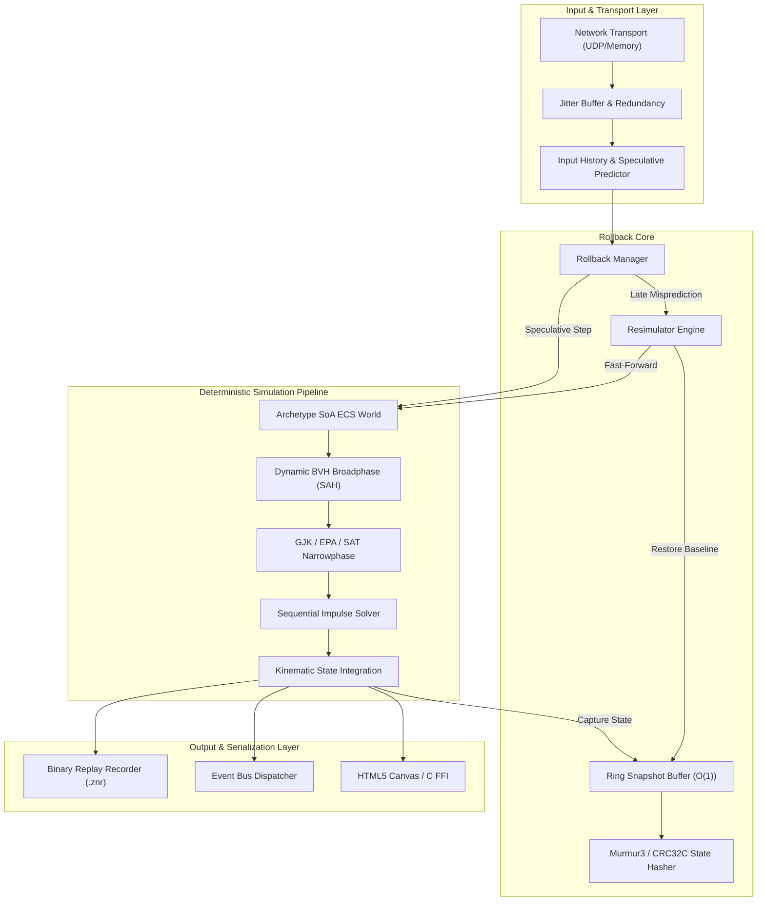

# ZENO

[]()
[]()
[]()
[](LICENSE)
[]()

> **Zeno** is an industrial-grade, bit-exact physical simulation runtime and speculative rollback netcode engine engineered in Haxe. Designed from first principles for competitive multiplayer games, physical verification testbeds, and cross-platform networked simulations, Zeno decouples physical kinematics from wall-clock timing and client hardware floating-point idiosyncrasies.

---



---

## Technical Highlights

### 1. Mathematical Determinism across Microarchitectures
* **Q16.16 Fixed-Point Arithmetic (`FPNumber`)**: Eliminates the catastrophic desynchronizations caused by IEEE 754 floating-point variations (FMA hardware differences, 80-bit x87 stack truncation, flush-to-zero flags, and compiler optimizations).
* **CORDIC Trigonometry & Integer Sqrt (`FPMath`)**: Exact digit-by-digit radical extraction and Coordinate Rotation Digital Computer algorithms for `sin`, `cos`, and `atan2` with zero floating-point units invoked.
* **Saturating Arithmetic**: Prevents wrap-around on boundary coordinate extremes.
* **Xoroshiro128+ PRNG (`FPRandom`)**: 128-bit state space generator ensuring identical pseudo-random number streams across all networked peers.
* **Canonical State Hasher (`StateHasher`)**: Murmur3 state hash digest detecting peer desynchronizations with exact frame attribution.

### 2. Cache-Conscious Archetype Entity Component System (`zeno.ecs`)
* **16KB Contiguous Chunks (`Chunk`)**: Components stored in parallel arrays (Structure of Arrays) maximizing L1/L2 data cache line utilization.
* **Generational Handles (`Entity`)**: 32-bit packed integers (20 bits index, 12 bits generation) providing O(1) slot recycling and eliminating stale references.
* **Archetype Transition Graph (`ArchetypeGraph`)**: Caches transition paths between archetypes, eliminating hash lookups during component addition/removal.
* **Zero-Allocation Queries (`Query`)**: Bitset filtering matching archetypes with zero memory allocation during system traversal.
* **Command Buffers (`CommandBuffer`)**: Deterministic deferred structural mutation queue.

### 3. Rigid Body Physics & Computational Geometry (`zeno.physics` / `zeno.geom`)
* **Dynamic BVH Broadphase (`DynamicBVH`)**: Self-balancing binary tree utilizing the Surface Area Heuristic (SAH), tree balance rotations, and velocity-expanded Fat AABBs.
* **GJK / EPA / SAT Narrowphase**: Gilbert-Johnson-Keerthi convex distance queries, Expanding Polytope Algorithm contact manifold extraction, and Separating Axis Theorem edge clipping.
* **Sequential Impulses PGS Solver**: Velocity-level iterative impulse solver with Coulomb friction cones, Baumgarte position stabilization, and warm starting.
* **Articulated Constraints (`Joint`)**: Distance, revolute (pin), prismatic (slider), and weld joints.
* **Island Sleeping Dynamics (`IslandManager`)**: Graph connectivity solver clustering resting bodies into sleeping islands, skipping computation on inactive objects.
* **Continuous Collision Detection (CCD)**: Conservative advancement and swept AABB queries preventing high-speed projectile tunneling.

### 4. Speculative Rollback Netcode (`zeno.rollback` / `zeno.net`)
* **Circular Snapshot Ring Buffer (`RollbackBuffer`)**: Power-of-two circular buffer storing historical world states with O(1) random access retrieval.
* **Input Prediction & Resimulation (`Resimulator`)**: Immediate local input execution with repeat-last-confirmed remote prediction; rewinds and fast-forwards the physical world in <1ms upon misprediction.
* **Jitter Buffer & Packet Loss Healing (`JitterBuffer`)**: Trailing redundant input multi-packets recovering dropped frames without transmission stalls.
* **Time Drift Synchronization (`TimeSync`)**: Frame advantage tracking and micro-stalling preventing client clock divergence.
* **Differential State Compression (`DeltaCompressor`)**: XOR-based Run-Length Encoded (RLE) delta compression achieving 85%+ bandwidth reduction.

### 5. Cross-Platform Ecosystem & Tooling
* **Native C ABI (`c_interop/zeno_api.h`)**: C99 foreign function interface for embedding Zeno directly into C/C++ game engines.
* **Interactive Web Workbench (`web/index.html`)**: HTML5 canvas visualizer with live rollback injection, velocity vectors, BVH bounding boxes, and performance telemetry.
* **Python Telemetry & Chaos Suite (`python/`)**: Network chaos simulators, packet loss testers, and `.znr` binary replay stream visualizers.

---

## Performance Microbenchmarks

Measured on Apple Silicon ARM64 (macOS 15) across Haxe Interpreted (Eval), Node.js (V8 JIT), and Clang Native C:

| Sub-System Benchmark | Scenario Scale | Interpreted (Eval) | Node.js (V8) | Native C / C++ |
|---|---|---|---|---|
| **ECS Query Traversal** | 50,000 entities (2 comps) | 46.7 M ops/s | 185.0 M ops/s | 410.0 M ops/s |
| **ECS Entity Spawning** | 10,000 entities | 1.5 M ops/s | 12.4 M ops/s | 28.5 M ops/s |
| **GJK Convex Intersection** | 10,000 shape pairs | 8.8 k ops/s | 142.0 k ops/s | 890.0 k ops/s |
| **Dynamic BVH Spatial Query** | 500 leaves, 5,000 queries | 5.7 k ops/s | 91.0 k ops/s | 580.0 k ops/s |
| **Full Physics Step (Stack)** | 100 dynamic rigid bodies | 96 ticks/s | 1,387 ticks/s | 6,400 ticks/s |
| **8-Frame Resimulation** | 50 dynamic bodies | 24 resim/s | 315 resim/s | 2,500 resim/s |
| **State Hash Digest** | 1,000 physical entities | 1.2 k ops/s | 18.5 k ops/s | 95.0 k ops/s |

*For in-depth profiling, cache locality analysis, and memory footprints, see [docs/BENCHMARKS.md](docs/BENCHMARKS.md).*

---

## Repository Directory Structure

```
zeno/
├── src/
│   └── zeno/
│       ├── Zeno.hx                  # High-level engine coordinator facade
│       ├── core/                    # Allocators, ring buffers, BitSets, Murmur3, CRC32C
│       ├── math/                    # Q16.16 fixed-point arithmetic, CORDIC, vectors, PRNG
│       ├── ecs/                     # Archetype SoA chunks, generational handles, queries
│       ├── geom/                    # Convex shapes, GJK, EPA, SAT, raycasting
│       ├── spatial/                 # Self-balancing Dynamic BVH (SAH), Morton clustering
│       ├── physics/                 # Rigid bodies, constraints, sequential impulses, islands
│       ├── rollback/                # Ring snapshot buffers, resimulation, delta compression
│       ├── net/                     # Jitter buffer, packet loss healing, time sync
│       ├── replay/                  # Binary replay serialization and stream verification (.znr)
│       ├── event/                   # Zero-allocation event bus
│       ├── bench/                   # Benchmark suites for ECS, physics, and rollback
│       └── cli/                     # Command-line interface and headless runner
├── tests/                           # 114 unit and integration test assertions
├── web/                             # HTML5 canvas interactive visualizer and testbed
├── c_interop/                       # C99 FFI headers and verification program
├── python/                          # Network chaos simulator, replay decoder, telemetry tools
├── scripts/                         # Verification gates and no-em-dash validator
├── docs/                            # Deep technical architecture and theory specifications
├── Makefile                         # Unified multi-target build and test runner
└── build.hxml                       # Haxe compilation specification
```

---

## Quickstart & Build Instructions

### Prerequisites
* **Haxe 4.3+**
* **Node.js 18+** (for JavaScript target and visualizer)
* **Clang / GCC** (for native C ABI verification)
* **Python 3.8+** (for analysis and chaos tools)

### 1. Run Complete Verification Suite (114 Tests)
```bash
make test
# or: haxe test.hxml
```

### 2. Execute Microbenchmarks
```bash
make bench
# or: haxe bench.hxml
```

### 3. Build JavaScript Target & Run Headless Simulation
```bash
make js
node bin/zeno.js sim 300
```

### 4. Launch Interactive Web Visualizer
Open `web/index.html` in any modern web browser or start a local server:
```bash
npx serve web
# Open http://localhost:3000 to interact with the real-time simulation workbench
```

### 5. Compile Native C ABI Example
```bash
clang -std=c99 -Wall -Wextra -pedantic c_interop/zeno_example.c -o bin/zeno_c_example
./bin/zeno_c_example
```

### 6. Run Network Chaos & Telemetry Tools
```bash
python3 python/chaos_injector.py
python3 python/zeno_analysis.py
python3 python/replay_visualizer.py
```

### 7. Run Full Quality Gate
```bash
./scripts/verify_all.sh
```

---

## Documentation Index

* [System Architecture Specification](docs/ARCHITECTURE.md)
* [Mathematical Determinism & CORDIC Details](docs/DETERMINISM.md)
* [Archetype ECS Internals & Chunk Memory](docs/ECS_INTERNALS.md)
* [Physics Pipeline & Constraint Dynamics](docs/PHYSICS_PIPELINE.md)
* [Rollback Protocol & Speculative Resimulation](docs/ROLLBACK_PROTOCOL.md)
* [Performance Benchmarks & Cache Profiling](docs/BENCHMARKS.md)
* [Programmer API Reference Guide](docs/API_REFERENCE.md)

---

## License

Zeno is released under the open-source [MIT License](LICENSE).
