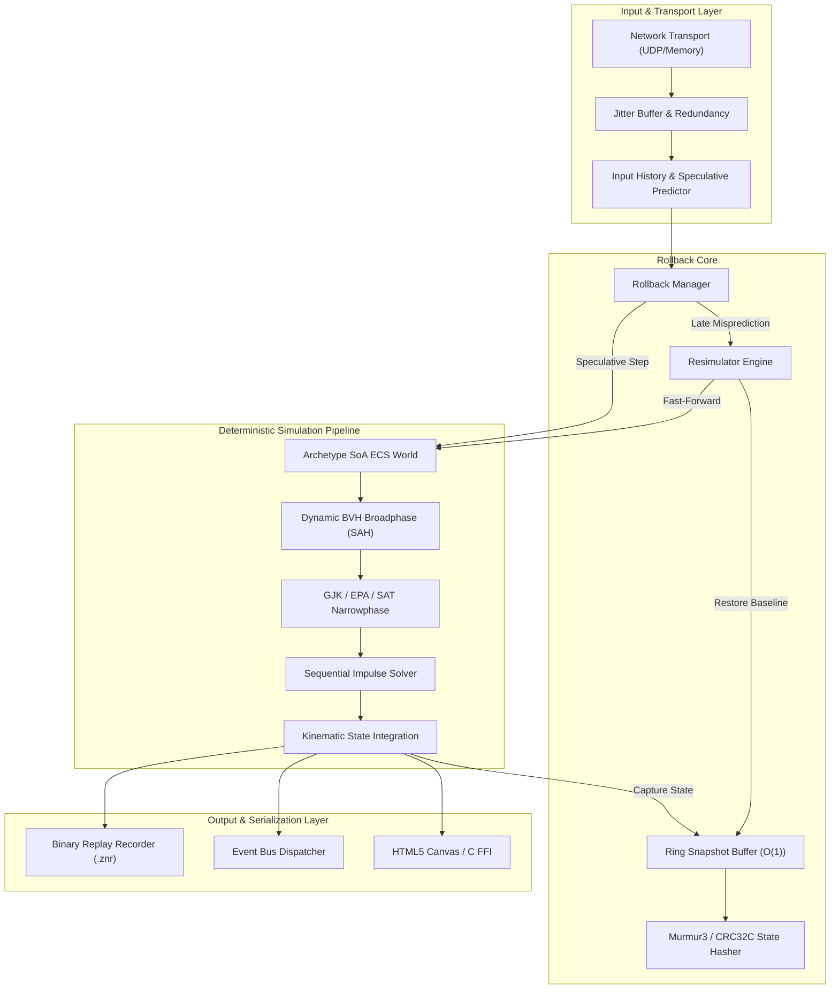

# Zeno System Architecture & Design Specification

Zeno is a deterministic physical simulation runtime and rollback netcode engine engineered in Haxe. Designed from first principles for competitive multiplayer simulations, physical verification testbeds, and cross-platform networked games, Zeno decouples physical kinematics from wall-clock timing and client hardware floating-point idiosyncrasies.

---

## 1. High-Level Architectural Overview

The engine is structured as a pipeline of decoupled sub-systems connected through typed boundaries and generational entity identifiers.



---

## 2. Core Sub-System Decomposition

### 2.1 Core Utilities (`zeno.core`)
Provides low-level data structures optimized for contiguous cache locality and zero dynamic heap allocation during steady-state ticks:
* **MemoryArena**: Fast monotonic linear memory allocator supporting bulk rewinds at frame boundaries.
* **ChunkPool / ObjectPool**: Pre-allocated pools for high-frequency objects, eliminating garbage collection pauses.
* **SparseSet**: O(1) insertion, deletion, and dense iteration for entity handles.
* **RingBuffer**: Power-of-two circular buffer with bitwise masking for deterministic FIFO streaming.
* **CRC32C / Murmur3**: Hardware-friendly, bit-exact checksum algorithms for state hash verification.

### 2.2 Bit-Exact Fixed-Point Math (`zeno.math`)
Eliminates cross-platform IEEE 754 floating-point divergence (FMA instructions, extended precision registers, transcendental library differences):
* **FPNumber**: Q16.16 signed fixed-point number (16 integer bits, 16 fractional bits, 1/65536 precision) with saturating arithmetic.
* **FPMath**: Fixed-point square root (integer digit-by-digit) and CORDIC circular trigonometric functions (`sin`, `cos`, `atan2`).
* **FPVector2 / FPVector3**: 2D and 3D spatial vector mathematics with dot, cross, distance, and normalized projections.
* **FPMatrix2x2 / FPMatrix3x3 / FPQuaternion**: Spatial coordinate transformations and rotations.
* **FPTransform / FPAABB**: Position and orientation transformations, bounding box unions and surface area evaluations.
* **FPRandom**: 64-bit Xoroshiro128+ pseudo-random number generator ensuring identical random streams across all machines.

### 2.3 Archetype-Based ECS (`zeno.ecs`)
High-performance Entity Component System organized around archetype graphs and Structure of Arrays (SoA) memory:
* **Generational Handles (`Entity`)**: 32-bit packed integer (20 bits index, 12 bits generation) preventing stale references.
* **Component Storage (`Chunk`)**: Fixed-size 16KB contiguous memory blocks storing components in parallel typed arrays for SIMD and cache efficiency.
* **Archetype Graph (`ArchetypeGraph`)**: Directed transition graph caching archetype transitions for O(1) component additions and removals.
* **Queries (`Query` / `QueryIterator`)**: Cached bitmask matching with `with()` and `without()` filters for rapid iteration over matched archetypes.
* **Command Buffer (`CommandBuffer`)**: Deferred structural mutations (spawns, deletions, component modifications) applied deterministically at phase boundaries.

### 2.4 Computational Geometry (`zeno.geom`)
Convex geometric primitives and GJK/EPA/SAT intersection algorithms:
* **Primitives**: Circle, Oriented Bounding Box (OBB), Capsule, and Convex Polygon.
* **Support Mappings**: Directional support point calculation for arbitrary convex shapes in local and transformed coordinate spaces.
* **Gilbert-Johnson-Keerthi (GJK)**: Fast iterative simplex distance algorithm determining convex overlap in O(k) iterations.
* **Expanding Polytope Algorithm (EPA)**: Contact normal and exact penetration depth manifold generation from deep simplex penetration.
* **Separating Axis Theorem (SAT)**: Analytical face-normal projection tests for oriented boxes and convex polygons.
* **Raycasting**: Deterministic ray vs. shape queries with exact time-of-impact (TOI) and surface hit normals.

### 2.5 Spatial Acceleration (`zeno.spatial`)
Spatial partitioning structures accelerating broadphase query throughput:
* **Dynamic BVH (`DynamicBVH`)**: Self-balancing binary tree utilizing Surface Area Heuristic (SAH) and tree rotations.
* **Fat AABBs**: Bounding box expansion with velocity prediction margins to reduce tree update frequency.
* **Morton Ordering**: 30-bit Z-order Morton codes for spatial clustering and cache-friendly node layout.

### 2.6 Physics Engine (`zeno.physics`)
Rigid body kinematics and constraint resolution:
* **Rigid Bodies (`RigidBody`)**: Static, kinematic, and dynamic bodies with mass, moment of inertia, linear and angular velocities.
* **Colliders (`Collider`)**: Shapes, friction, restitution, and category/mask bitfield filtering.
* **Contact Solver (`ContactConstraint`)**: Velocity-level sequential impulse solver with warm starting and cumulative impulse clamping.
* **Joints (`Joint`)**: Distance, revolute (pin), prismatic (slider), and weld constraints with Baumgarte stabilization.
* **Island Sleeping (`IslandManager`)**: Graph connectivity solver clustering resting bodies into sleeping islands to skip inactive computation.
* **Continuous Collision Detection (`ContinuousCollision`)**: Conservative advancement and swept AABB tests preventing tunneling of fast-moving bodies.

### 2.7 Rollback Netcode (`zeno.rollback`)
Speculative client-side prediction and sub-millisecond resimulation:
* **Snapshot Buffer (`RollbackBuffer`)**: Circular ring buffer storing historical entity states and PRNG seeds.
* **State Hasher (`StateHasher`)**: Canonical Murmur3 state hash computation detecting desynchronization across clients.
* **Input History (`InputHistory`)**: Per-player input streams tracking speculative predictions and confirmed remote inputs.
* **Resimulator (`Resimulator`)**: Instantaneous rewinding and fast-forwarding of the physical world upon late packet arrival.
* **Differential Compression (`DeltaCompressor`)**: XOR-based Run-Length Encoded (RLE) delta compression minimizing snapshot bandwidth.

### 2.8 Network & Replay Sub-Systems (`zeno.net` / `zeno.replay`)
* **Transport (`Transport` / `MemoryTransport`)**: Packet delivery abstractions for loopback testing, UDP sockets, and WebSockets.
* **Jitter Buffer (`JitterBuffer`)**: Loss healing buffer recovering dropped frames from redundant multi-packet payloads.
* **Time Synchronization (`TimeSync` / `FrameAdvantage`)**: Sliding-window drift calculation balancing client frame advantage within target boundaries.
* **Replay Stream (`ReplayStream` / `ReplayReader`)**: Binary serialization format (`.znr`) recording seeds, inputs, and periodic verification checkpoints.

---

## 3. Data Flow & Execution Pipeline

Every simulation tick follows a strictly ordered, idempotent pipeline:

```
[Start Tick N]
      │
      ▼
1. INGEST INPUTS
   ├── Read local player input for Tick N
   └── Predict unreceived remote player inputs (repeat last confirmed input)
      │
      ▼
2. CAPTURE SNAPSHOT
   ├── Serialize entity positions, angles, velocities, and sleeping flags
   ├── Record PRNG high/low internal states
   ├── Compute 32-bit Murmur3 state hash
   └── Save cloned snapshot into RollbackBuffer at slot (N % Capacity)
      │
      ▼
3. BROADPHASE SPATIAL PARTITIONING
   ├── Update Dynamic BVH with expanded Fat AABBs
   └── Collect potential collision pairs (query leaves against tree)
      │
      ▼
4. NARROWPHASE COLLISION DETECTION
   ├── Filter pairs by category/mask bitfields
   ├── Execute GJK distance test on convex shapes
   └── If intersecting, execute EPA to extract contact points, normal, and depth
      │
      ▼
5. CONSTRAINT SOLVING & INTEGRATION
   ├── Build contact and joint constraint equations
   ├── Warm-start solver using clamped impulses from previous tick
   ├── Execute 8 iterations of Sequential Impulses
   └── Integrate velocities into positions via semi-implicit Euler integration
      │
      ▼
6. ECS SYSTEM DISPATCH
   ├── Update user gameplay systems via Archetype Query Iterators
   └── Flush CommandBuffer structural mutations
      │
      ▼
[End Tick N -> Advance Clock to N + 1]
```

---

## 4. Cross-Platform Compilation Matrix

Zeno leverages Haxe's multi-target compiler to run on diverse target environments without modifying a single line of simulation logic:

| Target | Backend | Intended Use Case |
|---|---|---|
| **Interp / Eval** | Haxe VM | Instant test suite execution and continuous integration gates |
| **JavaScript / Node.js** | V8 / SpiderMonkey | Web browser interactive visualizer and headless Node.js game servers |
| **C++ (Hxcpp)** | Native Binaries | Production game clients, headless dedicated servers, and native benchmarks |
| **C ABI / FFI** | Native Shared Library | Embedding inside custom C/C++ game engines and simulations |
| **Python** | Glue & Analysis | Telemetry inspection, chaos testing, and automated replay auditing |
