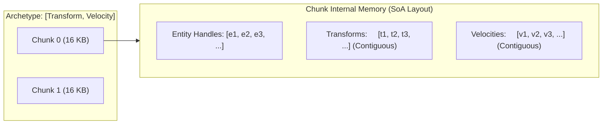
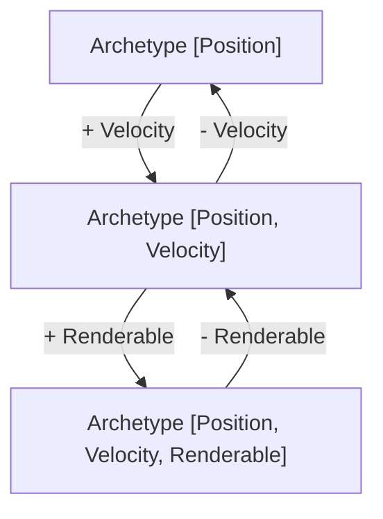

# Archetype Entity Component System (ECS) Internals

Zeno features a purpose-built archetype Entity Component System (ECS) engineered for high-throughput spatial simulations. Unlike traditional Object-Oriented hierarchies or naive component-array implementations, Zeno organizes entities with identical component signatures into dense, contiguous memory chunks.

---

## 1. Generational Entity Identifiers (`Entity`)

Entity handles in Zeno are packed 32-bit unsigned integers:

```
 31                        20 19                                0
┌────────────────────────────┬───────────────────────────────────┐
│  Generation Counter (12b)  │        Entity Index (20b)         │
└────────────────────────────┴───────────────────────────────────┘
```

* **Index (Lower 20 bits)**: Addresses up to `1,048,575` concurrent entity slots in the internal slot map.
* **Generation (Upper 12 bits)**: Counter incremented whenever an entity slot is recycled, supporting up to `4,095` reuses before wrap-around.
* **Safety Invariant**: When an entity is destroyed, its slot generation increments. Any stale references holding the previous generation fail validation in O(1) time, completely eliminating use-after-free bugs in game scripts.

---

## 2. Archetype Architecture & SoA Chunk Memory

An **Archetype** represents a unique combination of component types (e.g., `Transform + RigidBody + Collider`). All entities possessing the exact same component set reside together within that archetype.



### 2.1 16KB Fixed-Size Chunks
Entities inside an archetype are stored in a linked list of contiguous 16-kilobyte **Chunks**:
* **Cache Line Utilization**: Storing components in parallel arrays (Structure of Arrays) ensures that systems iterating over single components (e.g., integrating velocity into transform) stream memory sequentially through CPU L1/L2 caches without loading unused data.
* **Predictable Allocation**: Chunks are pooled and reused, keeping memory fragmentation near zero.
* **Swap-and-Pop Deletion**: When an entity is removed from a chunk, the last entity in the chunk moves into the vacant slot in O(1) time, maintaining dense packing without holes.

---

## 3. Archetype Transition Graph (`ArchetypeGraph`)

Adding or removing a component mutates an entity's archetype. Naive archetype ECS engines recalculate archetype hashes on every transition. Zeno implements a directed **Archetype Transition Graph**:



* Each archetype node maintains adjacency tables indexed by component type IDs for both addition and removal transitions.
* The first time an entity transitions between two archetypes, the edge is recorded in the graph.
* Subsequent transitions follow the pre-cached pointer in O(1) time without hash lookups or bitmask allocations.
* Entity component data is copied directly between chunk slots using high-speed block copies.

---

## 4. Zero-Allocation Query Pipeline (`Query` & `QueryIterator`)

Gameplay systems query entities matching specific component criteria (e.g., `All<RigidBody, Transform>`, `None<StaticBody>`):

1. **Bitmask Matching**: Each archetype maintains a 64-bit component bitmask. Query evaluation performs fast bitwise operations (`(archMask & withMask) == withMask && (archMask & withoutMask) == 0`).
2. **Archetype Matching Cache**: Archetypes matching a query are cached in an array. Newly created archetypes are registered into active queries upon creation.
3. **Chunk Traversal**: The `QueryIterator` walks directly through the contiguous component arrays of matched chunks, executing with zero heap allocation during traversal.

```haxe
// Zero-allocation iteration over matched physical bodies
world.query()
    .with(TransformComponent.TYPE)
    .with(RigidBodyComponent.TYPE)
    .without(StaticTag.TYPE)
    .forEach(function(entity: Entity, chunk: Chunk, index: Int) {
        var xf = chunk.getTransform(index);
        var body = chunk.getRigidBody(index);
        xf.position.x += body.velocity.x * dt;
    });
```

---

## 5. Command Buffers & Deferred Mutation (`CommandBuffer`)

Mutating the structural topology of the ECS (spawning entities, destroying entities, or adding/removing components) while iterating inside a system invalidates chunk pointers.

Zeno resolves this using deterministic **Command Buffers**:
* Systems record structural operations into a pre-allocated byte buffer.
* Operations are ordered sequentially and flushed at predefined phase boundaries (e.g., between physics integration and collision detection).
* Deferred playback ensures deterministic entity allocation order across all networked simulation peers.
