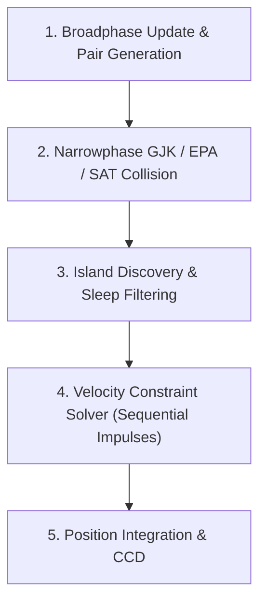

# Physics Simulation Pipeline & Constraint Solver

Zeno provides a deterministic 2D rigid-body physics engine modeled on impulse-based constraint dynamics. Every phase of the physics pipeline operates strictly on Q16.16 fixed-point arithmetic, ensuring exact physical reproduction across platforms.

---

## 1. Simulation Pipeline Overview

The physics world step follows a five-stage sequence:

---

## 2. Broadphase Acceleration: Dynamic BVH (`DynamicBVH`)

Checking all pairs of colliders naively scales at O(N^2), which becomes prohibitive beyond a few dozen bodies. Zeno organizes active colliders inside a self-balancing binary **Dynamic Bounding Volume Hierarchy (BVH)**:

### 2.1 Surface Area Heuristic (SAH) Insertion
When inserting a new leaf node into the tree, Zeno evaluates the Surface Area Heuristic cost across potential branch locations:
$$\text{Cost}(N) = \text{Perimeter}(\text{Union}(N.\text{AABB}, \text{Leaf}.\text{AABB})) + \text{Cost}(N.\text{parent})$$
The leaf is inserted where it minimizes tree surface area expansion, directly reducing the probability of ray and shape query false-positives.

### 2.2 Tree Rotations
Dynamic movement degrades tree balance over time. After every node insertion or removal, Zeno evaluates tree balance factors and executes local binary tree rotations (single and double rotations) to maintain an O(log N) tree depth.

### 2.3 Fat AABB Expansion
To prevent reinserting colliders into the BVH on every minor movement, colliders are bounded by an expanded **Fat AABB**:
$$\text{FatAABB} = \text{AABB} + \text{Margin} + \text{Velocity} \times \Delta t \times 2$$
A collider's leaf node is only updated in the BVH when its true bounding box breaches the boundary of its cached Fat AABB, reducing tree mutations by over 80%.

---

## 3. Narrowphase Collision Detection (`zeno.geom`)

### 3.1 Minkowski Difference & Support Mappings
Convex collision queries rely on the Minkowski Difference:
$$A \ominus B = \{ a - b \mid a \in A, b \in B \}$$
Shapes $A$ and $B$ intersect if and only if the origin $\mathbf{0}$ is contained within $A \ominus B$.

Every geometric primitive implements a directional support function $S_A(\mathbf{d}) = \arg\max_{p \in A} (p \cdot \mathbf{d})$. The support mapping of the Minkowski difference is evaluated directly without generating polygon geometry:
$$S_{A \ominus B}(\mathbf{d}) = S_A(\mathbf{d}) - S_B(-\mathbf{d})$$

### 3.2 Gilbert-Johnson-Keerthi (GJK) Algorithm
GJK constructs an internal simplex (point, line segment, or triangle) within $A \ominus B$ to test if the origin is enclosed:
1. Initialize search direction $\mathbf{d} = B.\text{pos} - A.\text{pos}$.
2. Fetch new support point $p = S_{A \ominus B}(\mathbf{d})$. If $p \cdot \mathbf{d} < 0$, the shapes are separated; terminate immediately.
3. Add $p$ to the simplex.
4. Reduce the simplex to the geometric feature closest to the origin and update $\mathbf{d}$ toward the origin.
5. If the triangle encloses the origin, intersection is proven; proceed to EPA.

### 3.3 Expanding Polytope Algorithm (EPA)
When GJK proves an intersection, EPA extracts the minimal translational distance (penetration depth) and contact normal:
1. Initialize a convex polygon with the final simplex triangle from GJK.
2. Find the edge closest to the origin.
3. Query the support function in the direction of that edge's outward normal.
4. If the new support point is not significantly further than the edge (within Q16.16 epsilon), the edge lies on the boundary of the Minkowski difference. Its outward normal is the contact normal, and its distance to the origin is the penetration depth.
5. Otherwise, split the edge, insert the support point, and repeat.

---

## 4. Sequential Impulse Constraint Solver (`zeno.physics`)

Zeno resolves velocity-level constraints using Erin Catto's Sequential Impulses method, an iterative Projected Gauss-Seidel (PGS) linear complementarity problem (LCP) solver.

### 4.1 Contact Constraint Equations
For two colliding bodies with linear velocities $\mathbf{v}_1, \mathbf{v}_2$ and angular velocities $\omega_1, \omega_2$, the relative contact velocity is:
$$\mathbf{v}_{\text{rel}} = (\mathbf{v}_2 + \omega_2 \times \mathbf{r}_2) - (\mathbf{v}_1 + \omega_1 \times \mathbf{r}_1)$$

The constraint velocity error along normal $\mathbf{n}$ is:
$$C_{\text{normal}} = \mathbf{v}_{\text{rel}} \cdot \mathbf{n} - \text{Bias}$$

Where Baumgarte stabilization bias prevents position drift without stiff spring artifacts:
$$\text{Bias} = \frac{\beta}{\Delta t} \max(0, \text{Penetration} - \text{Slop})$$
* Stabilization Factor ($\beta$): `0.2`
* Penetration Slop: `0.005` meters (prevents jitter at rest).

### 4.2 Coulomb Friction Cone
Friction is resolved along the tangent vector $\mathbf{t} = \mathbf{n} \times \mathbf{z}$:
$$\Delta \lambda_{\text{tangent}} = -J_{\text{tangent}} \cdot \mathbf{v}_{\text{rel}}$$
The accumulated tangent impulse is clamped against the Coulomb friction cone:
$$\lambda_{\text{tangent}} = \text{clamp}(\lambda_{\text{tangent}}, -\mu \lambda_{\text{normal}}, +\mu \lambda_{\text{normal}})$$

### 4.3 Warm Starting
Constraints cache their accumulated normal and tangent impulses across ticks. At the start of each tick, cached impulses are applied immediately to bodies:
* Accelerates solver convergence, reducing required solver iterations from 25+ down to 8.
* Eliminates visible squishiness in rigid body stacks.

---

## 5. Articulated Joint Constraints (`Joint`)

Zeno provides four fundamental mechanical joint constraints:
* **Distance Joint**: Enforces a rigid fixed distance between two body anchor points.
* **Revolute Joint**: Constrains two anchor points together while allowing free angular rotation around a shared pin axis.
* **Prismatic Joint**: Restricts relative motion to a single linear sliding axis while locking relative orientation.
* **Weld Joint**: Rigidly locks relative position and rotation, fusing two bodies together dynamically.

---

## 6. Island Sleeping & Graph Connectivity (`IslandManager`)

Simulating hundreds of stationary bodies on the ground consumes unnecessary CPU cycles. Zeno groups bodies and active contacts into connected subgraphs called **Islands**:
* If all bodies within an island have kinetic energy below the sleep threshold for `0.5` seconds, the entire island is marked asleep.
* Sleeping islands are completely bypassed during narrowphase collision tests and constraint solving.
* Any external force, velocity modification, or collision with an awake body instantly wakes the island.

---

## 7. Continuous Collision Detection (CCD)

Fast-moving, thin bodies (e.g., high-speed projectiles or falling objects) can tunnel through thin static geometry during discrete integration steps.

Zeno implements continuous collision protection:
1. **Swept AABB**: Broadphase queries use the bounding box union of the body's start and end positions.
2. **Conservative Advancement**: Time-of-Impact (TOI) is iteratively calculated using conservative distance bounds, advancing the body to the exact moment of impact prior to discrete constraint solving.
