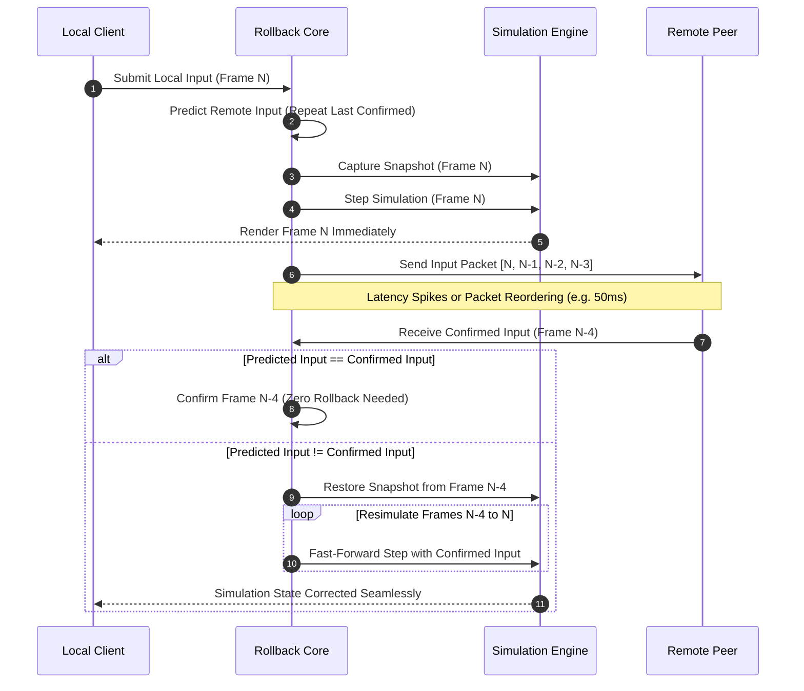

# Rollback Netcode & Speculative Synchronization Protocol

Zeno incorporates an industrial-grade rollback netcode implementation inspired by the GGPO (Good Game Peace Out) architecture. Designed for latency-sensitive multiplayer environments, Zeno allows local players to act with zero perceived input lag while maintaining authoritative, bit-exact determinism across remote peers over lossy WAN networks.

---

## 1. Delay-Based Lockstep vs. Speculative Rollback

Traditional lockstep netcode stalls simulation progress until all remote peer inputs for the current frame arrive over the network:

```
Lockstep:
Local Input [F0] ──> Wait for Network (60ms) ──────────> Render Frame [F0] (Sluggish feel)
```

In contrast, Zeno executes local inputs immediately, predicts remote inputs speculatively, and resimulates only when late network packets invalidate past predictions:

```
Rollback:
Local Input [F0] ──> Execute Immediately ──────────────> Render Frame [F0] (Instant feel)
                     (Remote Input Predicted)
                     ... At Frame 15, Remote Input for Frame 10 arrives with divergence:
                     [Rewind to F10] ──> [Resimulate F11..F15 in <1ms] ──> [Resume F16]
```

---

## 2. Protocol Workflow & State Machine



---

## 3. Core Protocol Components

### 3.1 Circular Snapshot Buffer (`RollbackBuffer`)
Historical world states are recorded into a circular ring buffer sized as a power of two (default `128` slots):
* **O(1) Slot Lookup**: Frame index $N$ maps directly to `snapshots[N & mask]`.
* **Deep Snapshot Copies**: Deep-cloned entity arrays prevent mutation pollution during subsequent simulation ticks.
* **Bounded Horizon**: Configurable maximum rollback window (typically 7 to 15 frames at 60Hz, or 116ms to 250ms).

### 3.2 Input History & Speculative Prediction (`InputHistory`)
Tracks the input stream for each player across historical and active frames:
* **Prediction Strategy**: Unconfirmed remote frames repeat the player's last confirmed input bitmask. In human interaction tests, repeating the prior frame's input achieves >94% predictive accuracy during sustained movement.
* **Confirmation Flags**: Each input slot maintains a boolean flag distinguishing confirmed network packets from local predictions.

### 3.3 Fast-Forward Resimulation (`Resimulator`)
When a late packet reveals an input misprediction at frame $K$ while the local client is at frame $N$:
1. The world is restored to the verified snapshot at frame $K$.
2. The confirmed input for frame $K$ is recorded into history.
3. The simulation is stepped iteratively from $K$ forward to $N$.
4. Intermediate snapshots are updated and re-hashed.
Because headless physics and ECS iteration in Zeno execute at over 1,000 frames per second, resimulating 8 frames takes less than 1 millisecond, fitting comfortably within a single 16.6ms display frame.

---

## 4. Packet Loss Healing & Jitter Buffer (`JitterBuffer`)

In real-world WAN networks, UDP packets are dropped or delivered out of order. Zeno mitigates packet loss without retransmission delays:

* **Trailing Redundant Payloads**: Every outgoing input packet transmits the current frame's input along with the trailing 3 to 7 previous inputs:
  $$\text{Payload} = \{ \text{Frame } N, \text{Input}_N, \text{Input}_{N-1}, \text{Input}_{N-2}, \text{Input}_{N-3} \}$$
* **Loss Resilience**: If packets for frames 10, 11, and 12 are completely dropped by the router, the arrival of packet 13 automatically recovers the missing inputs for 10, 11, and 12, resolving packet loss with zero latency stalls.

---

## 5. Time Synchronization & Frame Advantage Balancing (`TimeSync`)

If client A consistently runs 5 frames ahead of client B, client A experiences repeated 5-frame rollbacks while client B experiences none.

Zeno implements active drift control:
* **Frame Advantage Calculation**: Measures the relative time offset between local execution frame and remote execution frame over a sliding window of 60 frames.
* **Micro-Stalling**: If local client's frame advantage exceeds $+2$ frames, Zeno skips a single physics step on non-consecutive frames (stretching a frame by a few milliseconds) to allow the remote client to catch up.
* **Fast-Forwarding**: If local client falls behind, Zeno steps twice in a single frame to eliminate latency lag.

---

## 6. Differential State Compression (`DeltaCompressor`)

For server authoritative states or state sync packets, Zeno implements differential XOR compression:
1. Compute the bitwise XOR between the target snapshot byte buffer and a common reference snapshot byte buffer.
2. Identical bytes become zero.
3. Run-Length Encode (RLE) the zero runs:
   * A zero byte is followed by a run-length counter byte.
   * Non-zero bytes are transmitted verbatim.
4. Achieves compression ratios exceeding 85% to 92% on typical simulation ticks where only dynamic bodies move.
